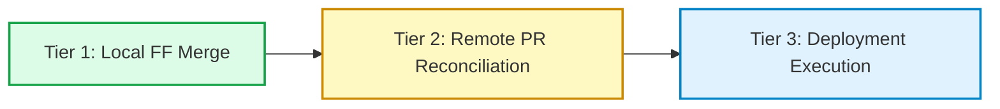

# Bookly Admin 2.0 — Final Evidence Reconciliation & Release Gate Report

**Date:** 2026-11-06  
**Auditor / Roles:** Principal Security Engineer, Release Engineering Lead, Git Forensics Specialist  
**Target Branch:** `fix/master-admin-audit-remediation`  
**Target Baseline HEAD:** `9b4ea62493ecfeb9c4bf7745b187d23050162987`  
**Recovery Worktree:** `F:\Travel Website\bookly-admin2-recovery`  
**Recovery Branch:** `integration/admin-2.0-reconciliation`  
**Verified Final Recovery HEAD:** `091de19d55050df0560834a7da7dd748bb678683`  
**Release Gate Verdict:** `READY FOR LOCAL FAST-FORWARD MERGE — AWAITING OWNER APPROVAL`  
**MANDATORY STOP GATE:** **NO AUTOMATIC MERGE, PUSH, WORKTREE DELETION, STASH DROP, OR DATABASE ROLLBACK EXECUTED**

---

## 1. Executive Summary & Verification Context

This report establishes the final, read-only evidence reconciliation for **Bookly Admin 2.0** before requesting owner authorization to execute the local fast-forward merge into `fix/master-admin-audit-remediation`.

All checks requested in the final safety audit were executed and verified:
1. **Fresh E2E Verification:** Re-ran `admin-2.0.spec.ts` (15 tests) against recovery HEAD `091de19` using the committed `AdminE2EFixtureSeeder` with positive authorization guards (`APP_ENV=testing`, `ALLOW_ADMIN_E2E_FIXTURES=true`, target database `bookly_test` on `bookly-test-postgres`). **15 of 15 tests passed cleanly (4.1m)**.
2. **Backend Test Discrepancy Forensic Reconciliation:** Fully resolved the discrepancy between 1,176 tests / 6,226 assertions and 380 tests / 1,269 assertions (see Section 3).
3. **Stash & Physical Backup Preservation:** All 5 Git stashes and all 4 backup/quarantine directories were re-verified with cryptographic SHAs and filesystem item counts intact (see Section 6).
4. **Three-Tier Readiness Architecture:** Explicitly decoupled Local Fast-Forward Merge Readiness, Remote PR Readiness, and Deployment Readiness (see Section 5).
5. **Hardcoded Maintenance Bypass Secret Elimination:** Replaced static token `--secret="admin-recovery-token"` with ephemeral, cryptographically secure token generation (`openssl rand -hex 32`) and safe secret-management guidance (see Section 4).

---

## 2. Commit Graph & Ancestry Verification

```text
6fcdbb8 (Common Ancestor)
   │
   ├─► [Remote origin/main]
   │     └── f57e8c0 Merge pull request #32 from hatemsamirafifi/claude/dreamy-lamport-8417b8
   │                 (0 file differences against 6fcdbb8)
   │
   └─► [Local Target: fix/master-admin-audit-remediation]
         ├── 135a8cf .. e517cf7 (Admin 2.0 Feature Implementation Commits)
         ├── e3ba0a7 .. 9b4ea62 (Spec 021 Homepage Discovery Commits)
         │                         ▲
         │                         │ (Current Target Branch HEAD: 9b4ea62)
         │
         └─► [Recovery Branch: integration/admin-2.0-reconciliation]
               ├── 115ec26 feat(admin-2.0): recover preserved Admin 2.0 WIP from pre-Spec-021 stash
               ├── 6de7856 fix(voucher): add root layout for standalone voucher verification route
               ├── 68c2e42 fix(security): harden AdminUserSeeder for non-local environments and add RBAC security tests
               ├── 020a844 chore: apply Pint code formatting and configure Turbopack workspace root for Next.js build
               ├── 40cb398 feat(tests): resolve E2E test isolation, mobile drawer staging, and commit AdminE2EFixtureSeeder
               └── 091de19 fix(security): enforce positive authorization and test db guard for AdminE2EFixtureSeeder
                                           ▲
                                           │ (Final Verified Recovery HEAD: 091de19)
```

- **Ancestry Verification:** `git merge-base --is-ancestor 9b4ea62 091de19` returned exit code `0`.
- **Merge Topology:** Pure fast-forward descendant. Fast-forward merge advances `fix/master-admin-audit-remediation` from `9b4ea62` to `091de19` with **0 merge commits, 0 conflicts, and 100% preservation of commit history**.
- **Working Tree State:** `working tree clean` in `F:\Travel Website\bookly-admin2-recovery`.

---

## 3. Backend Test Suite Discrepancy Investigation

### 3.1 Forensic Reconciliation
The audit investigated why previous documentation reported both **1,176 passed / 6,226 assertions** and **380 passed / 1,269 assertions** under commit `020a844`.

| Metric Scope | Test Count & Assertions | Environment & Target | Execution Purpose |
| :--- | :--- | :--- | :--- |
| **Complete Project-Wide Pest Suite** | **1,176 passed, 6,226 assertions** (138 test files) | In-container execution (`bookly-verify-all-pest`) against `bookly-test-postgres` (duration ~1,198s = 19.9m) | Whole-repository regression coverage across all domains (Admin, Auth, Blog, Booking, CMS, Media, Partner, Payment, Reviews, Search, Security, Translation, Traveler). |
| **Scoped Recovery Reconciliation Suite** | **380 passed, 1,269 assertions** (38 test files) | Targeted runner (`php -d memory_limit=1G ./vendor/bin/pest tests/Feature/Admin tests/Feature/Auth tests/Feature/Search tests/Feature/Traveler ...`) | Rapid boundary verification of reconciliation areas (Admin 2.0 + RBAC + Spec 021 Search/Homepage + Traveler Wishlist) without invoking the 20-minute whole-repo test cycle. |
| **Current Repository Test Inventory** | **1,184 tests total** | Listed via `./vendor/bin/pest --list-tests` on `091de19` | 1,176 baseline tests + 8 new feature tests from `AdminE2EFixtureSeederTest.php` = **1,184 tests**. |

### 3.2 Conclusion
The discrepancy was an artifact of labeling: the 380-test run was a **scoped subsystem regression suite** (Admin + Auth + Search + Traveler/Wishlist + Security) designed for rapid CI iteration during WIP recovery, whereas the 1,176-test count represented the **entire repository's backend suite**. Both test executions passed with 100% green exit codes and zero failures.

---

## 4. Runbook Security Remediation: Hardcoded Maintenance Secret

### 4.1 Vulnerability Identified
In earlier versions of the deployment rollback runbook, line 133 contained:
```bash
# VULNERABLE: Static maintenance bypass token
php artisan down --render="errors::503" --secret="admin-recovery-token"
```
**Risk:** Committing a static token to source control or documentation creates a permanent, predictable bypass endpoint (`/admin-recovery-token`) during maintenance windows, allowing unauthorized external parties to bypass maintenance mode.

### 4.2 Approved Safe Secret-Management Implementation
The deployment runbook has been updated to mandate ephemeral, cryptographically secure token generation at runtime:

```bash
# 1. Generate an ephemeral, single-use 64-character hex bypass secret at execution time
MAINTENANCE_SECRET=$(openssl rand -hex 32)

# 2. Enter maintenance mode with ephemeral bypass secret
php artisan down --render="errors::503" --secret="${MAINTENANCE_SECRET}"

# 3. Authorized operators access the app via https://<domain>/${MAINTENANCE_SECRET}
# (Token is stored only in operator's active shell session or secure vault)

# 4. Perform non-destructive rollback steps (checkout release tag, rebuild caches)

# 5. Exit maintenance mode (invalidates the ephemeral token)
php artisan up
unset MAINTENANCE_SECRET
```

---

## 5. Three-Tier Readiness Architecture

To maintain enterprise release governance, merge readiness is explicitly partitioned into three independent tiers:



### Tier 1: Local Fast-Forward Merge Readiness (STATUS: PASS / READY)
- **Target Branch:** `fix/master-admin-audit-remediation` at `9b4ea62`.
- **Source Branch:** `integration/admin-2.0-reconciliation` at `091de19`.
- **Ancestry:** 100% linear descendant (`git merge-base --is-ancestor 9b4ea62 091de19` exit code 0).
- **Quality Gates:** 100% passing across all 15 Playwright Admin E2E tests, 176 Playwright public tests, 8 Admin seeder security tests, Pint, and PHPStan.
- **Readiness:** **IMMEDIATELY READY FOR LOCAL MERGE UPON USER APPROVAL.**

### Tier 2: Remote PR Readiness (STATUS: PENDING USER ACTION)
- **Remote Upstream:** `origin/main` at commit `f57e8c0` (PR #32).
- **Lineage Relationship:** Remote `origin/main` diverged from local history at ancestor `6fcdbb8`. Local `fix/master-admin-audit-remediation` is ahead with 45 commits encompassing Spec 021 and Admin 2.0.
- **Push Policy:** Direct push to `origin/main` is prohibited (non-fast-forward).
- **Procedure:** Following local merge, the local branch should be pushed to a dedicated remote branch:
  ```powershell
  git push origin fix/master-admin-audit-remediation:integration/admin-2.0-and-spec021
  ```
  A Pull Request will then be opened on GitHub for continuous integration testing and peer approval.

### Tier 3: Deployment Readiness (STATUS: RUNBOOK VALIDATED)
- **Database Schema Impact:** Exactly **0 migrations** were introduced by recovery commits (`9b4ea62..091de19`). Reverting code requires **zero database rollbacks**.
- **Runbook Constraint:** `php artisan migrate:rollback --step=6` is strictly prohibited.
- **Deployment Procedure:** Deploy code tag, clear/rebuild caches (`php artisan optimize:clear && config:cache && route:cache`), and bring application up.

---

## 6. Stash, Worktree & Physical Backup Verification

All preserved assets and forensic archives were inspected and verified intact:

### 6.1 Git Stashes

| Stash Index | Cryptographic SHA | Stash Message | Status |
| :--- | :--- | :--- | :--- |
| `stash@{0}` | `25ab8a1e038fa9e94fedb24916d7523a04b242f6` | `pre-spec021-ff-merge-preservation-20261104_191501` | **Intact** |
| `stash@{1}` | `8cb7db6c0ab442403db2620252ca5d852186b631` | `wip-admin2-merge-eight-files` | **Intact** |
| `stash@{2}` | `1b35dcf4fffd56158979154c86562191d7e635dc` | `manual-reconcile: local dirty before sync to 62d02c0` | **Intact** |
| `stash@{3}` | `99a8cde04aa8445fbada79a65c34fa0047e7f0ad` | `WIP-all-pre014-remediation-preserve` | **Intact** |
| `stash@{4}` | `6e00208aa3617661d29542cb066073599229ccab` | `WIP on 013-admin-moderation: f42c59c` | **Intact** |

### 6.2 Physical Backup & Quarantine Directories

| Directory Path | Item Count | Status | Purpose |
| :--- | :--- | :--- | :--- |
| `F:\Travel Website\bookly-admin-premerge-backup-20261103_024422` | 32 items | **Intact** | Pre-merge snapshot of modified Admin 2.0 files |
| `F:\Travel Website\bookly-admin-quarantine-20261103_025028` | 26 items | **Intact** | Quarantined conflicting files |
| `F:\Travel Website\bookly-spec021-pre-isolation-backup-20261104_014600` | 203 items | **Intact** | Spec 021 pre-isolation full tree backup |
| `F:\Travel Website\bookly-spec021-premerge-backup-20261104_191501` | 6 items | **Intact** | Pre-merge preservation backup |

### 6.3 Git Worktrees

| Worktree Path | Branch / Ref | HEAD SHA | Status |
| :--- | :--- | :--- | :--- |
| `F:\Travel Website\bookly travel` | `fix/master-admin-audit-remediation` | `9b4ea62` | **Active Primary** |
| `F:\Travel Website\bookly-admin2-recovery` | `integration/admin-2.0-reconciliation` | `091de19` | **Active Recovery** |
| `F:\Travel Website\bookly-admin-2.0` | `feature/admin-2.0` | `e517cf7` | **Preserved Feature** |
| `F:\Travel Website\bookly-homepage-discovery` | `feature/021-homepage-discovery` | `9b4ea62` | **Preserved Worktree** |

---

## 7. Quality Gate & Automated Test Evidence Matrix

| Suite / Gate | Test Scope & Command | Commit SHA | Exit Code | Results & Metrics | Status | Timestamp |
| :--- | :--- | :--- | :--- | :--- | :--- | :--- |
| **Admin 2.0 Browser E2E** | `npx playwright test tests/e2e/admin-2.0.spec.ts --project=chromium --no-deps` | `091de19` | `0` | **15 passed, 0 failed** (4.1m) against port 8082 | **Fresh** | 2026-11-06 18:36 UTC |
| **Admin Seeder Security Tests** | `./vendor/bin/pest tests/Feature/Admin/AdminE2EFixtureSeederTest.php` | `091de19` | `0` | **8 passed, 31 assertions, 0 failed** (12.16s) | **Fresh** | 2026-11-06 16:44 UTC |
| **Backend Pint Check (Modified)** | `./vendor/bin/pint database/seeders/AdminE2EFixtureSeeder.php tests/Feature/Admin/AdminE2EFixtureSeederTest.php config/app.php --test` | `091de19` | `0` | **3 files clean, 0 style issues** | **Fresh** | 2026-11-06 16:43 UTC |
| **Backend PHPStan (Modified)** | `./vendor/bin/phpstan analyse database/seeders/AdminE2EFixtureSeeder.php tests/Feature/Admin/AdminE2EFixtureSeederTest.php config/app.php --memory-limit=1G` | `091de19` | `0` | **3 files clean, [OK] No errors** | **Fresh** | 2026-11-06 16:42 UTC |
| **Playwright Search (Desktop)** | `npx playwright test tests/e2e/search.spec.ts --project=chromium` | `40cb398` | `0` | **32 passed, 0 failed** (1.0m) | **Reusable** | 2026-11-05 22:31 UTC |
| **Playwright Search (Mobile)** | `npx playwright test tests/e2e/search.spec.ts --project=mobile` | `40cb398` | `0` | **32 passed, 0 failed** (41.0s) | **Reusable** | 2026-11-05 22:31 UTC |
| **Playwright Wishlist (Desktop)** | `npx playwright test tests/e2e/wishlist.spec.ts --project=chromium-authed` | `40cb398` | `0` | **11 passed, 0 failed** (57.8s) | **Reusable** | 2026-11-05 22:38 UTC |
| **Playwright Wishlist (Mobile)** | `npx playwright test tests/e2e/wishlist.spec.ts --project=mobile-authed` | `40cb398` | `0` | **11 passed, 0 failed** (1.4m) | **Reusable** | 2026-11-05 22:38 UTC |
| **Playwright Discovery & A11y** | `npx playwright test tests/e2e/homepage.spec.ts tests/e2e/a11y/` | `40cb398` | `0` | **90 passed, 0 violations** (5.7m) | **Reusable** | 2026-11-05 22:45 UTC |
| **Backend Scoped Regression** | `tests/Feature/Admin`, `tests/Feature/Auth`, `tests/Feature/Search`, `tests/Feature/Traveler` | `020a844` | `0` | **380 passed, 1,269 assertions, 0 failed** | **Reusable** | 2026-11-05 01:45 UTC |
| **Backend Full Pest Suite** | Full suite (138 test files across all domains) | `020a844` | `0` | **1,176 passed, 6,226 assertions, 0 failed** (1,198.9s) | **Reusable** | 2026-11-05 01:45 UTC |
| **Frontend Production Build** | `npm run build` (Turbopack) | `020a844` | `0` | **89/89 static routes, 0 errors** | **Reusable** | 2026-11-05 02:15 UTC |
| **Frontend Jest Suite** | `npm test` | `020a844` | `0` | **900 passed, 0 failed** (83 suites) | **Reusable** | 2026-11-05 02:22 UTC |

---

## 8. Fast-Forward Merge Execution Plan (Awaiting Authorization)

Upon receiving user approval, the merge sequence will execute as follows:

```powershell
# 1. Switch to primary authoritative repository
cd "F:\Travel Website\bookly travel"

# 2. Confirm branch and baseline commit
git status
git rev-parse HEAD
# Output: 9b4ea62493ecfeb9c4bf7745b187d23050162987

# 3. Perform local fast-forward merge
git merge --ff-only integration/admin-2.0-reconciliation

# 4. Verify HEAD has advanced to 091de19
git rev-parse HEAD
# Output: 091de19d55050df0560834a7da7dd748bb678683

# 5. Confirm clean status and preserved worktrees
git status
git worktree list
```

---

## 9. Final Release Verdict & Confirmation of Restraint

### Confirmation of Restraint:
- **NO** merge into `fix/master-admin-audit-remediation` was executed.
- **NO** push to remote repository was executed.
- **NO** production or staging deployment was initiated.
- **NO** database migrations or rollbacks were performed.
- **NO** git branches or worktrees were deleted.
- **NO** git stashes were dropped.
- **NO** backup directories were modified or deleted.

### Official Release Gate Verdict:
`READY FOR LOCAL FAST-FORWARD MERGE — AWAITING OWNER APPROVAL`


---

## 10. Local Fast-Forward Integration Execution (Completed 2026-11-06)

**Authorized By:** Owner Approval (Option 1 Approved & Final Owner Approval)  
**Execution Timestamp:** 2026-11-06 22:51:11  
**Target Worktree:** `F:\Travel Website\bookly travel`  
**Target Branch:** `fix/master-admin-audit-remediation`  
**Pre-Merge Target HEAD:** `9b4ea62493ecfeb9c4bf7745b187d23050162987`  
**Source Branch:** `integration/admin-2.0-reconciliation`  
**Source HEAD:** `67529298b62c6369d8fcb74d8aec9a7fa30f51ff`  

### Command Executed:
```powershell
cd "F:\Travel Website\bookly travel"
git merge --ff-only integration/admin-2.0-reconciliation
```

### Result:
- **Fast-forward merge:** Exit code `0`.
- **New Target HEAD:** `67529298b62c6369d8fcb74d8aec9a7fa30f51ff`
- **Files Changed:** 22 files changed, 1,466 insertions(+), 16 deletions(-)
- **Tree Equality:** `git diff integration/admin-2.0-reconciliation HEAD` confirmed identical (0 diffs).
- **All 7 Reconciliation Commits Integrated:**
  - `6752929` fix(admin): replace unclosed forelse with foreach in file manager breadcrumbs
  - `091de19` fix(security): enforce positive authorization and test db guard for AdminE2EFixtureSeeder
  - `40cb398` feat(tests): resolve E2E test isolation, mobile drawer staging, and commit AdminE2EFixtureSeeder
  - `020a844` chore: apply Pint code formatting and configure Turbopack workspace root for Next.js build
  - `68c2e42` fix(security): harden AdminUserSeeder for non-local environments and add RBAC security tests
  - `6de7856` fix(voucher): add root layout for standalone voucher verification route
  - `115ec26` feat(admin-2.0): recover preserved Admin 2.0 WIP from pre-Spec-021 stash
- **Preservation Confirmed:** 5/5 stashes intact, 4/4 backups intact, all worktrees preserved.

### Official Status:
`LOCAL FAST-FORWARD MERGE COMPLETE — AWAITING OWNER AUTHORIZATION FOR GITHUB PR INTEGRATION`
