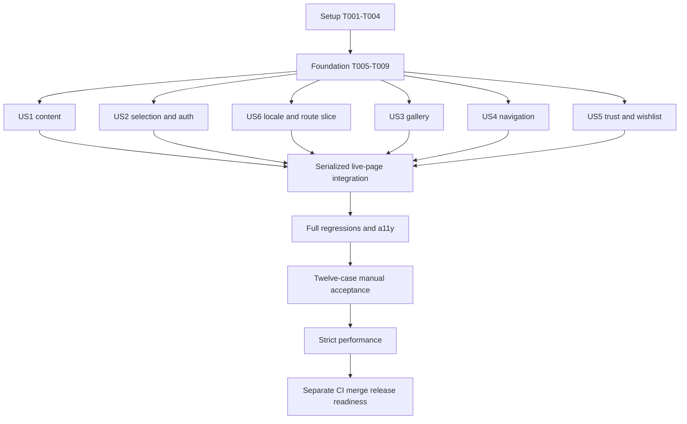

# Tasks: Tour Detail Experience

**Input**: Design documents in `specs/020-tour-detail-experience/`  
**Prerequisites**: [plan](plan.md), [specification](spec.md), [research](research.md), [data model](data-model.md), [consumer contract](contracts/tour-detail-consumer.md), [UI contract](contracts/tour-detail-ui.md), [quickstart](quickstart.md)  
**Spec ID / Master-plan phase**: Spec 020 / Phase 3  
**Governing Constitution**: [Bookly v2.1.0](../../.specify/memory/constitution.md)  
**Branch / baseline**: `codex/020-tour-detail-experience` at `4afdbc6`, containing merged Spec 019 PR #29 (`origin/main` recorded at `9e241b9`) and six retained shell commits from `codex/header-navigation-polish`. Verify current merge/deployment readiness separately; preserve 018/019 and existing unrelated files.  
**Created**: 2026-10-14 (Africa/Cairo)  
**Status**: Implementation in progress: setup T001–T004 accepted against retained local baseline evidence; 70 tasks remain. Feature runtime acceptance, CI, merge and release completion are not claimed.

**Tests**: Required by the specification and constitution for the changed critical journey, shared interactions and source-language/SEO behavior. Write meaningful failing behavioral tests before implementing the relevant change; retain exact red/green output. Fixture preparation and behavior-preserving harness extraction must retain existing passing assertions. Do not assert failure solely because a planned file is missing.

**Organization**: Shared setup/foundation, then P1 stories US1/US2/US6, then P2 stories US3/US4/US5, and final integrated gates. Task-phase numbers do not redefine master-plan Phase 3. Story labels retain their specification numbers.

## Format: `[ID] [P?] [Story] Description`

Each executable task is an unchecked checklist line with a unique sequential ID and exact repository-relative file paths. New files named below are implementation targets, not claims that they exist. `[P]` permits work on different files only after stated prerequisites/test baselines are complete; it does not authorize simultaneous changes to shared files or concurrent mutable fixture/performance runs. A task is checked only after its acceptance evidence is retained in `specs/020-tour-detail-experience/verification.md` or its evidence directory.

## Phase 1: Setup and baseline

**Purpose**: Establish the actual source/runtime/test boundary without recreating the existing app or changing dependencies.

- [X] T001 Verify current branch, active feature pointer, fetched main ancestry, Spec 019 deployment prerequisite and retained shell dependency; record exact commits and separate known/pending statuses in `specs/020-tour-detail-experience/verification.md`, using `.specify/feature.json` and `specs/020-tour-detail-experience/plan.md` as authorities.
- [X] T002 Review governing instructions and the installed Next image/server-client/error documentation where bundled, then audit all planned file/primitive references against actual source; record verified versions, available docs and any discrepancy in `specs/020-tour-detail-experience/verification.md`, using `frontend/AGENTS.md`, `frontend/node_modules/next/dist/docs/`, `frontend/package.json` and `frontend/src/components/ui/` (do not assume a missing bundled guide exists).
- [X] T003 [P] Verify the owned proxy/API, production SSR harness prerequisites, disposable PostgreSQL configuration, seeded auth and deterministic payment mode; record commands/readiness without secrets in `specs/020-tour-detail-experience/evidence/environment.md`, using `frontend/playwright.config.ts`, `backend/phpunit.pgsql.xml` and `docker-compose.test.yml`.
- [X] T004 Capture focused existing tour/booking/page/schema Jest and public/backend contract baselines with the applicable quickstart commands in `specs/020-tour-detail-experience/evidence/baseline/`; record genuine pre-existing failures in `specs/020-tour-detail-experience/verification.md` before modifying source.

**Checkpoint**: Baseline is explicit, test data is owned, and real failures have reproducible evidence. An unavailable runtime is not a passing baseline.

## Phase 2: Foundational presentation and test infrastructure

**Purpose**: Shared inputs, visibility/language projection, localization names and SSR harness required by story work.

- [ ] T005 Create immutable complete/sparse/fallback/intentional-empty/unavailable/broken-media fixture builders with injectable UTC clocks in `frontend/tests/fixtures/tour-detail.ts`; use existing `frontend/src/lib/api/types.ts`, real-response provenance and future dates, without generating unavailable facts or mutating shared tours.
- [ ] T006 [P] Add failing visibility/order/language projection tests in `frontend/src/lib/tours/__tests__/detail-presentation.test.ts` for the model constraints "Optional text uses trimmed nonempty checks; arrays require actual usable entries" and "itinerary fallback additionally requires nonempty itinerary", including whitespace text, zero reviews, null difficulty/operator and intentional empty translated itinerary.
- [ ] T007 Implement only pure section-presence/order and actual-language derivations in `frontend/src/lib/tours/detail-presentation.ts` after T006; use stable existing section IDs, preserve supplied values/order and exact empty-versus-missing meaning, and pass the focused tests without moving backend translation selection into the browser.
- [ ] T008 [P] Extract the existing built Next/local API fixture harness into `frontend/tests/e2e/helpers/tour-detail-ssr.ts` and update `frontend/tests/e2e/tour-detail.spec.ts`; preserve all existing assertions, isolate ports/process lifetime and prove real SSR reads still pass rather than replacing them with browser route mocks (after T005 and baseline capture).
- [ ] T009 [P] Define the shared new control/state/estimate/fallback/gallery/nav/auth-recovery copy keys consistently in `frontend/messages/en.json`, `frontend/messages/es.json` and `frontend/messages/it.json`; preserve existing keys and supply all three translations before consuming them (after T005; serialize later catalog edits).

**Checkpoint**: T005–T009 complete, pure-model tests pass, and the retained SSR harness can run. No new persistent store, schema, backend endpoint or dependency is introduced.

## Phase 3: User Story 1 — Understand the experience (Priority: P1)

**Goal**: Ordered, truthful readable content using the existing gallery/nav/commerce until their own story upgrades.

**Independent Test**: Complete/sparse tours show the prescribed header→photos→nav→overview→facts→highlights→itinerary→practical→operator→reviews→related order, omit absent sections/entries, preserve important information and expose full descriptions.

### Tests first

- [ ] T010 [P] [US1] Add failing overview/disclosure tests in `frontend/src/components/tour/__tests__/TourOverview.test.tsx` for "600-code-point preview only when longer", Unicode-safe preview, full-text reachability, expanded relationships and focus restoration before hiding descendants.
- [ ] T011 [P] [US1] Add failing section rendering/order/empty/lang/facts/practical-content assertions in `frontend/src/components/tour/__tests__/TourSections.test.tsx`; verify authentic supplied values, unchanged itinerary order, localized spoken-language names and no invented map/cancellation/rating facts.

### Implementation

- [ ] T012 [P] [US1] Create server-compatible `frontend/src/components/tour/TourHeader.tsx`, `frontend/src/components/tour/TourFacts.tsx` and `frontend/src/components/tour/TourHighlights.tsx`, reusing Breadcrumbs/RatingBadge/wishlist and supplied title/location/facts; header review access is conditional and guide-language names belong in facts (after T011).
- [ ] T013 [P] [US1] Implement the narrow interactive `frontend/src/components/tour/TourOverview.tsx` with the model's "600-code-point preview only when longer", complete selected-language text and safe collapse/focus behavior (after T010).
- [ ] T014 [P] [US1] Extract ordered day/stop rendering into `frontend/src/components/tour/TourItinerary.tsx`, preserving actual itinerary language, supplied descriptions and intentional emptiness without inventing stops, times or coordinates (after T011).
- [ ] T015 [P] [US1] Implement `frontend/src/components/tour/TourInclusions.tsx` and `frontend/src/components/tour/TourMeetingPoint.tsx` using shared Accordion and fully readable meeting/cancellation/important-information content; absent sections disappear with their entries (after T011).
- [ ] T016 [US1] Compose the approved header/gallery/nav/article/practical/trust order in server-compatible `frontend/src/components/tour/TourDetail.tsx`, using the shared presence model and narrow client children; preserve existing operator/review/related/gallery/booking behavior until replaced by later stories (after T012–T015).
- [ ] T017 [US1] Apply the <1024 single-column and ≥1024 article/sidebar layout through `frontend/src/components/tour/TourDetail.tsx` and semantic tokens in `frontend/src/app/globals.css` only where needed; preserve current shell and avoid raw repeated brand/z-index values (after T016).
- [ ] T018 [US1] Extend `frontend/src/components/tour/__tests__/TourDetail.test.tsx` and `frontend/tests/e2e/tour-detail.spec.ts` with actual SSR complete/sparse ordering, important-information retention, disclosure accessibility and no orphan entries; replace brittle old layout selectors with semantic assertions (after T016–T017).
- [ ] T019 [US1] Run US1 component/SSR checks and inspect representative complete/sparse desktop/mobile pages; retain red/green results and hierarchy evidence in `specs/020-tour-detail-experience/evidence/us1/` and `specs/020-tour-detail-experience/verification.md`.

**Checkpoint**: Readable-content MVP is independently demonstrable with existing gallery/booking. This does not accept the later gallery/navigation improvements or the full spec.

## Phase 4: User Story 2 — Date, party and checkout continuation (Priority: P1)

**Goal**: One valid selection owner for both booking actions, accurate cents estimate and safe full-selection authentication recovery.

**Independent Test**: From search choose a non-default future date and valid count; both actions and resize retain identical query/estimate, login/register/expired-session recovery keeps selections, invalid cases cannot continue and server rejection remains authoritative.

### Tests first

- [ ] T020 [P] [US2] Add failing pure booking tests in `frontend/src/lib/tours/__tests__/booking-selection.test.ts` quoting "a real offered `YYYY-MM-DD` date strictly after current UTC today", "min/max are positive safe integers and min ≤ max" and "the multiplied result a safe integer"; cover malformed/today/past/unlisted dates, >30 offered dates, missing next date, equal bounds, fractional/nonfinite values, unsupported currency and overflow.
- [ ] T021 [P] [US2] Add failing shared-card/bar/controller tests in `frontend/src/components/tour/__tests__/TourBookingController.test.tsx` for "CSS viewport visibility does not remount/reset it" and "fresh supplied props invalidate selections that no longer belong to dates/bounds"; cover invalidation reasons, hydration snapshot, UTC rollover, selection summary, duplicate control IDs and dialog return focus.
- [ ] T022 [P] [US2] Add failing full-query return and checkout401 recovery tests in `frontend/src/components/booking/__tests__/BookingForm.test.tsx` and `frontend/src/lib/auth/__tests__/return-url.test.ts`; preserve stable idempotency/double-submit/price-drift assertions and reject external/cross-locale return paths without automatic resubmission.

### Implementation

- [ ] T023 [US2] Implement safe offered-future-date/count/cents/currency eligibility, estimate and unchanged checkout query builder in `frontend/src/lib/tours/booking-selection.ts`; enforce "Base amount must be a positive safe integer", preserve current EUR/divisor100 contract and fail invalid inputs before calling `frontend/src/lib/utils.ts` formatCurrency (after T020).
- [ ] T024 [US2] Implement `frontend/src/components/tour/TourBookingController.tsx` as the single page-local state owner for selectedDate/count, injected server UTC-day snapshot, interaction/midnight recheck, identity reset and fresh-prop invalidation without silent substitution; no global/localStorage state (after T021/T023).
- [ ] T025 [US2] Implement controlled `frontend/src/components/tour/BookingCard.tsx` and refactor `frontend/src/components/tour/AvailabilityCalendar.tsx` into the labelled all-offered-future-date selector; show integer count limits/base per-person price/currency/estimate and only supported cancellation copy, with identical invalid/unavailable guards (after T024).
- [ ] T026 [US2] Implement `frontend/src/components/tour/MobileBookingBar.tsx` using the same controller, current summary and shared Dialog selectors; unique IDs, no hidden focusable duplicate controls, measured safe-area/bar spacing and real trigger focus restoration (after T024–T025).
- [ ] T027 [US2] Add the bounded shared safe-auth continuation adapter in `frontend/src/lib/tours/booking-selection.ts` and `frontend/src/components/booking/BookingForm.tsx`: wait for auth restoration, encode complete same-locale booking query through existing safeAuthReturnUrl, preserve login/registration return, handle expired-session401 and never automatically submit or alter provider/idempotency rules (after T022–T026).
- [ ] T028 [US2] Integrate one persistent booking boundary with server-rendered article children in `frontend/src/components/tour/TourDetail.tsx` and pass the server UTC-day snapshot from `frontend/src/app/[locale]/(public)/tours/[slug]/page.tsx`; prove viewport changes do not remount state and sidebar spans the reading content (after T027).
- [ ] T029 [US2] Migrate all old live consumers/tests of `frontend/src/components/tour/BookingCTA.tsx` and `frontend/src/components/tour/MobileBookingAction.tsx` to the controller-backed card/bar; keep only necessary compatibility wrappers with no independent date/count logic and retain unavailable/deep-link regressions (after T028).
- [ ] T030 [US2] Extend public signed-out SSR/browser cases in `frontend/tests/e2e/tour-detail.spec.ts` for non-default/index31 date, count, resize, UTC clock boundary and full returnUrl through login/registration, including invalid/unavailable states (after T027–T029).
- [ ] T031 [US2] Extend authenticated `frontend/tests/e2e/booking.spec.ts` and existing BookingForm tests for401 return, full-query restoration, sold-out409/schedule422/price drift, same-selection retries and duplicate protection; use owned deterministic fixtures and preserve existing payment/confirmation assertions (after T027–T030).
- [ ] T032 [US2] Perform actual public-response→tour→selection→checkout integration using owned tours and deterministic gateway, with complete URLs/payload provenance and unchanged integer totals; retain evidence in `specs/020-tour-detail-experience/evidence/us2/` without exposing tokens/secrets (after T031).
- [ ] T033 [US2] Run focused US2 unit/public/authenticated browser checks serially against owned mutable fixtures; record resulting passes/failures and remaining environment issues in `specs/020-tour-detail-experience/verification.md` (after T032).

**Checkpoint**: Detail preparation and safe auth continuation pass independently; full locale/overlay/performance acceptance still requires the remaining stories and final gates.

## Phase 5: User Story 6 — Language, access and page states (Priority: P1)

**Goal**: Correct selected languages, localized interface/state/metadata and safe route recovery; interaction-wide acceptance remains shared with later stories.

**Independent Test**: In all locales, current/independent fallback/intentional-empty cases show the correct notices/lang/SEO; unknown/archived/denied/loading/recoverable states expose no private content or enabled invalid booking.

### Tests first

- [ ] T034 [P] [US6] Add failing language/intentional-empty/whitespace-copy tests in `frontend/src/components/tour/__tests__/TourDetail.test.tsx` and catalog parity assertions in `frontend/src/lib/tours/__tests__/detail-localization.test.ts`; selected content/itinerary/image languages and guide-language names remain independent.
- [ ] T035 [P] [US6] Add failing archived404/410/recoverable422/429/denied and localized metadata/noindex tests in `frontend/src/app/[locale]/(public)/tours/[slug]/__tests__/page.test.tsx`, including no fabricated schema rating/offer or private upstream error messages.

### Implementation

- [ ] T036 [US6] Apply actual-language attributes and independent localized nonempty fallback disclosures throughout `frontend/src/components/tour/TourDetail.tsx`, `frontend/src/components/tour/TourItinerary.tsx` and relevant static sections using the shared model; preserve intentional empty translated itinerary and fresh source reads without polling (after T034).
- [ ] T037 [US6] Add route-local `frontend/src/app/[locale]/(public)/tours/[slug]/loading.tsx` and `error.tsx` using shared LoadingSkeleton/ErrorState, locale catalogs and safe retry/recovery; applicable loading/empty/error/success/disabled/denied states remain distinct (after T035).
- [ ] T038 [US6] Handle known GoneError as localized withdrawn/no-booking/noindex in `frontend/src/app/[locale]/(public)/tours/[slug]/page.tsx`; retain NotFoundError semantics, localize metadata failures and preserve backend410 rather than inventing a Next HTTP410 mechanism (after T035–T037).
- [ ] T039 [US6] Audit and repair all new keys/translations and long-copy behavior in `frontend/messages/en.json`, `frontend/messages/es.json` and `frontend/messages/it.json`; add no raw interface fallback strings and keep image-language attributes away from page-localized controls (after T036–T038).
- [ ] T040 [US6] Extend the actual built SSR response/metadata cases in `frontend/tests/e2e/tour-detail.spec.ts` and `frontend/src/components/seo/__tests__/StructuredData.test.tsx` for locale reload/current derivative/independent fallback/intentional-empty/archive/noindex and genuine visible-data agreement (after T039).
- [ ] T041 [US6] Establish the twelve-combination and keyboard/reduced-motion/modal-state acceptance cases in `frontend/tests/e2e/a11y/tour-detail-a11y.spec.ts`; preserve existing real loaded-review coverage and clearly stage new gallery/nav/wishlist checks for T069 after their implementations (after T040).
- [ ] T042 [US6] Verify localized route/loading/retry/denied/withdrawn states with controlled SSR plus actual API status evidence; record expected actual-backend-versus-rendered-frontend behavior in `specs/020-tour-detail-experience/evidence/us6/` (after T037–T041).
- [ ] T043 [US6] Run scoped language/route/page/schema tests and record the US6 content/state checkpoint in `specs/020-tour-detail-experience/verification.md`; do not mark full interaction/matrix acceptance complete before T069–T070.

**Checkpoint**: US6 content/route/localization slice passes independently. Gallery/nav/wishlist-specific focus acceptance is intentionally completed after US3/US4/US5; cross-cutting behavior is not falsely declared independent.

## Phase 6: User Story 3 — Genuine photographs (Priority: P2)

**Goal**: Sparse desktop mosaic, full-width mobile swipe/controls and shared accessible viewer with truthful broken-photo states.

**Independent Test**: Zero/one/four/>five photo cases reach every supplied image via supported input methods; current count/order/lang remain accurate, image loading does not move layout and close returns to the actual trigger.

### Tests first

- [ ] T044 [P] [US3] Add failing gallery state/layout/order/broken/lang tests in `frontend/src/components/tour/__tests__/TourGallery.test.tsx` for "Failed item keeps stable slot/count and honest placeholder", empty-gallery no-viewer, sparse no-duplicates and localized controls independent of alt_locale.
- [ ] T045 [P] [US3] Add failing pointer/keyboard/touch/swipe/open-close/browser cases in `frontend/tests/e2e/tour-detail.spec.ts` for all-photo reachability, body inertness, no focus reset on arrow navigation and stable geometry; keep existing genuine-media assertions (after completed US2/US6 edits to this shared file).

### Implementation

- [ ] T046 [US3] Implement `frontend/src/components/tour/TourGallery.tsx` state and ≥1024 large-cover/up-to-four-supporting mosaic versus <1024 full-width scroll-snap mobile rail/counter/visible controls, preserving supplied order and no duplicate tile padding (after T044–T045).
- [ ] T047 [US3] Use existing `frontend/src/components/ui/Dialog.tsx` from `frontend/src/components/tour/TourGallery.tsx` for full-screen viewer, named controls, scoped arrow navigation and actual trigger focus return; avoid duplicate page locks/refocusing close on each image (after T046).
- [ ] T048 [US3] Implement same-sized localized missing/broken-photo slots, failed-index tracking and actual alt/description language in `frontend/src/components/tour/TourGallery.tsx`; keep remaining media reachable and original real total count (after T047).
- [ ] T049 [US3] Set stable responsive aspect ratios, measured sizes, one initial hero loading strategy and lazy supporting/viewer media in `frontend/src/components/tour/TourGallery.tsx`, reusing `frontend/src/lib/images.ts` placeholders without invented tour photography (after T048).
- [ ] T050 [US3] Replace the live gallery in `frontend/src/components/tour/TourDetail.tsx`; migrate old `frontend/src/components/tour/ImageGallery.tsx` consumers/tests to the canonical TourGallery or a thin compatible wrapper with no second modal/state engine (after T049).
- [ ] T051 [US3] Run focused gallery/shared Dialog tests and browser touch/keyboard/focus/layout acceptance; retain evidence and source commit in `specs/020-tour-detail-experience/evidence/us3/` and `specs/020-tour-detail-experience/verification.md` (after T050).

## Phase 7: User Story 4 — Reading navigation (Priority: P2)

**Goal**: Sticky anchor navigation with accurate visible-section tracking and unobstructed targets.

**Independent Test**: Activate/scroll/resize complete and sparse pages; headings remain visible below actual sticky surfaces, active cues follow reading without taking focus and entries remain reachable without whole-page overflow.

### Tests first

- [ ] T052 [P] [US4] Add failing activation/observation/resize/absent-section tests in `frontend/src/components/tour/__tests__/TourSectionNav.test.tsx`, quoting "passive updates never take focus" and ensuring active IDs reference only present sections.
- [ ] T053 [P] [US4] Add failing browser scroll/anchor/long-label/keyboard/reduced-motion target-obstruction cases in `frontend/tests/e2e/tour-detail.spec.ts`, measuring actual heading visibility and focus rather than only hash change (after T045–T051 shared-file work).

### Implementation

- [ ] T054 [US4] Refactor `frontend/src/components/tour/TourSectionNav.tsx` into a narrow observation client island retaining native anchors/aria-current=location, visible noncolor cue and horizontal active-entry reveal that never scrolls the page vertically (after T052–T053).
- [ ] T055 [US4] Coordinate measured nav/actual sticky obstruction through ResizeObserver/IntersectionObserver and shared semantic offset styles in `frontend/src/components/tour/TourSectionNav.tsx` and `frontend/src/app/globals.css`; current relative header is not assumed fixed, and reduced motion uses immediate activation scrolling (after T054).
- [ ] T056 [US4] Connect shared present-section IDs and target-heading focus/scroll margins through `frontend/src/components/tour/TourDetail.tsx` and section components; explicit activation focuses the revealed heading while passive reading never steals focus (after T055).
- [ ] T057 [US4] Run focused nav tests and browser full/sparse/resize/keyboard acceptance, retaining overlap/active-entry/focus evidence in `specs/020-tour-detail-experience/evidence/us4/` and `specs/020-tour-detail-experience/verification.md` (after T056).

## Phase 8: User Story 5 — Trust, save and comparison (Priority: P2)

**Goal**: Genuine reviews/operator/related facts and accessible wishlist outcomes using existing authorization/workflows.

**Independent Test**: Real/zero reviews and present/absent operators/related lists show only supported facts; related links retain locale; signed-in/out wishlist success/failure/denial is accurate and recoverable.

### Tests first

- [ ] T058 [P] [US5] Add failing genuine/zero-review/verified/null-operator/empty-related tests in `frontend/src/components/tour/__tests__/TourReviews.test.tsx`, `frontend/src/components/tour/__tests__/OperatorSummary.test.tsx` and `frontend/src/components/tour/__tests__/RelatedTours.test.tsx`; no scored stars without eligible reviews, no verified claim unless true and no padded recommendations.
- [ ] T059 [P] [US5] Add failing saved/rollback/status-error/denied/login-prompt dialog tests in `frontend/src/components/wishlist/__tests__/WishlistButton.test.tsx`; preserve debounce, API ownership/auth and optimistic rollback while requiring actual-outcome announcements and focus return.

### Implementation

- [ ] T060 [US5] Implement `frontend/src/components/tour/TourReviews.tsx` as a presentation wrapper around `frontend/src/components/reviews/ReviewList.tsx`, preserving full review browsing/authorization and real count/average; zero reviews create no empty scored section/entry (after T058).
- [ ] T061 [US5] Restyle `frontend/src/components/tour/OperatorSummary.tsx` and `frontend/src/components/tour/RelatedTours.tsx` with existing tokens/primitives, retaining public allowlisted facts, verified===true and eligible supplied cards/current-locale routes without private fields or invented data (after T058).
- [ ] T062 [US5] Add announced real outcomes/rollback and shared Dialog prompt focus behavior to `frontend/src/components/wishlist/WishlistButton.tsx`, preserving token checks/debounce/server authorization and providing no false saved-success on failure (after T059).
- [ ] T063 [US5] Integrate trust sections and conditional header review navigation in `frontend/src/components/tour/TourDetail.tsx` and `frontend/src/components/tour/TourHeader.tsx`; verify consistency of genuine header/section counts and no duplicate wishlist state engines (after T060–T062).
- [ ] T064 [US5] Extend real public/signed-out cases in `frontend/tests/e2e/tour-detail.spec.ts` and signed-in cases in `frontend/tests/e2e/wishlist.spec.ts` for genuine trust/locale links, actual saved/failure/denied states and prompt focus; use controlled failure boundaries plus real API success (after T063).
- [ ] T065 [US5] Run focused trust/review/wishlist and affected shared Dialog regressions, retaining outcomes/privacy/focus evidence in `specs/020-tour-detail-experience/evidence/us5/` and `specs/020-tour-detail-experience/verification.md` (after T064).

## Phase 9: Polish, integration and acceptance gates

**Purpose**: Validate the assembled feature and separate source completion from CI/merge/release readiness. Dependencies: all story implementation/checkpoint tasks; then gate tasks in the order below.

- [ ] T066 Run frontend lint/typecheck/full Jest/production build as documented in `specs/020-tour-detail-experience/quickstart.md`; inspect server/client boundaries and retained no-store loader in `frontend/src/lib/api/tours.ts`, resolve regressions and retain exact outputs in `specs/020-tour-detail-experience/evidence/final/frontend/`.
- [ ] T067 Run actual PostgreSQL public-detail/availability/create-booking/payment regression suites with explicit `backend/phpunit.pgsql.xml`, including `backend/tests/Feature/Search/TourDetailTest.php`, `TourAvailabilityLogicTest.php`, `AvailabilityResolutionRegressionTest.php`, `backend/tests/Feature/Booking/CreateBookingTest.php` and `backend/tests/Feature/Payment/`; include affected auth/review/authorization regressions by actual impact and record all commands/results in `specs/020-tour-detail-experience/evidence/final/backend/` (one database owner, after T066).
- [ ] T068 Run affected public/mobile/authenticated tour/booking/checkout/payment/wishlist browser suites from `frontend/tests/e2e/` against built app/owned fixtures; verify new authenticated filenames are matched correctly in `frontend/playwright.config.ts`, retain safe full-query login/register401 return, idempotency and server-rejection evidence (after T066–T067).
- [ ] T069 Complete all new/retained EN/ES/IT×390/768/1024/1440 automated a11y/keyboard/reduced-motion cases in `frontend/tests/e2e/a11y/tour-detail-a11y.spec.ts` after gallery/nav/wishlist are integrated; run affected shared-shell/checkout/wishlist a11y suites and retain results in `specs/020-tour-detail-experience/evidence/final/a11y/` (after T068).
- [ ] T070 Manually verify all twelve locale/width layouts and gallery/mobile-selector/wishlist-prompt modal states, focus/contrast/copy/scroll-obstruction/spacing/safe-area behavior under `specs/020-tour-detail-experience/contracts/tour-detail-ui.md`; retain screenshots and reproducible manual checks in `specs/020-tour-detail-experience/evidence/final/visual/`, completing cross-story US6 acceptance (after T069).
- [ ] T071 Extend strict `frontend/lighthouserc.js` with ES/IT detail URLs while retaining EN home/search/tour/blog, three runs and pessimistic performance≥0.9; verify `.github/workflows/lighthouse.yml` uses this config and no weaker legacy/default config or reduced route set substitutes for acceptance (after T070).
- [ ] T072 Run the strict production Lighthouse collector serially under documented cold/resource conditions via the quickstart, expecting eighteen reports across six URLs; every locale's tour minimum must be≥90, failed/unreachable/missing reports block acceptance, and all reports/traces/settings are retained in `specs/020-tour-detail-experience/evidence/final/performance/` (after T071; no concurrent builds/tests/audits).
- [ ] T073 Recheck Constitution v2.1.0, requirement evidence, actual source-head CI and shell dependency merge/target deployment/rollback readiness against `specs/020-tour-detail-experience/plan.md`; record implementation, runtime gates, CI, merge and release separately in `specs/020-tour-detail-experience/verification.md` without deploying/merging as a side effect (after T072).
- [ ] T074 Update the final acceptance/remaining-gap record in `specs/020-tour-detail-experience/verification.md`, verified commands in `quickstart.md` and phase status in `docs/bookly-ui-redesign-spec-kit-master-plan.md`; mark this ledger's tasks only against retained evidence, preserve earlier specs and do not declare wider redesign or deployment complete (after T073).

## Dependencies & Execution Order

### Phase dependencies

1. Setup T001–T004 precedes foundation T005–T009. T003 can overlap source review T002 if data/output ownership is distinct; runtime-dependent baseline T004 waits for environment readiness.
2. Within foundation: T005 precedes fixture-consuming tasks; T006 precedes T007. After fixture/baseline readiness, T006/T008/T009 can run concurrently on different files; T008 is an existing-behavior harness migration, not an unfinished-feature assertion.
3. Default integration sequence is US1→US2→US6→US3→US4→US5 because each touches TourDetail, catalogs, or shared browser tests. This is an integration/file-ownership constraint, not a claim that every story's new logic is needed for another story's unit tests.
4. Static section, booking model/controller, gallery and nav logic can be developed/tested against foundation fixtures independently. Before integrating into the live page, reserve TourDetail/page/catalog/E2E ownership and preserve earlier changes.
5. US6 content/state tests are independent; its complete gallery/nav/wishlist focus and twelve-case interaction acceptance depend explicitly on US2/US3/US4/US5 and finish at T069–T070. No false independent completion claim.
6. Final T066–T074 are sequential gates; mutable database/browser fixture owners and performance audits never overlap. Failures must be resolved or documented with reproduced pre-existing evidence; missing gates are not passes.

### Dependency graph

### Within each story

Record red behavioral assertions first, implement pure state/presentation before live wiring, rerun only affected tests until stable, then run the story checkpoint. Keep prior critical behavior assertions intact. New missing files are designated targets; imports/types must be made compilable before claiming meaningful red results.

### Parallel examples per story

These examples describe available implementation lanes; they do not dispatch agents or change authorization.

| Story | Safe parallel example after prerequisites | Serialize |
|---|---|---|
| US1 | T010 overview tests with T011 section tests; after red tests T012 header/facts, T013 overview, T014 itinerary and T015 practical files. | T016–T019 shared compositor/integration. |
| US2 | T020 pure-model tests, T021 controller tests and T022 BookingForm/return-url tests. | T023–T029 state/card/bar/auth wiring; T030–T033 shared browser/mutable integration. |
| US6 | T034 content/catalog tests and T035 route/metadata tests. | T036–T043 catalogs/page/shared SSR/a11y edits; final overlay acceptance later. |
| US3 | T044 unit cases and T045 browser cases when that shared E2E file is exclusively owned. | T046–T050 all alter the canonical gallery/live page. |
| US4 | T052 unit observer tests and T053 browser target checks when the shared E2E file is exclusively owned. | T054–T056 nav/offset/live heading integration. |
| US5 | T058 trust component tests and T059 wishlist tests. After red cases, T060 reviews, T061 operator/related and T062 wishlist can be allocated distinct owners. | T063–T065 header/compositor/browser acceptance. |

Unmarked implementation lanes in US5 require explicit ownership scheduling; never infer all story phases can safely edit the same page at once. `[P]` markers identify tasks that can overlap at their eligible stage, not tasks exempt from prerequisite checks.

## Requirement and outcome coverage

Ranges below are inclusive; task associations are coverage, not completion evidence.

| Requirements | Implementation / test tasks | Outcomes |
|---|---|---|
| FR-001 | T001,T035,T038,T040,T067,T073 | SC-006,SC-009 |
| FR-002–008 | T006–007,T010–019,T034,T036 | SC-001,SC-005 |
| FR-009–012 | T044–051,T069–072 | SC-004,SC-005,SC-007 |
| FR-013–014 | T052–057,T069–070 | SC-005,SC-007 |
| FR-015–022 | T020–033,T066–070 | SC-002,SC-003,SC-005,SC-009 |
| FR-023–026 | T058–065,T068–070 | SC-006,SC-009 |
| FR-027–028 | T006–009,T034,T036,T039–043,T048 | SC-005,SC-006 |
| FR-029–031 | T010,T021,T026,T034–043,T044–065,T069–070 | SC-005,SC-006,SC-007 |
| FR-032 | T035,T038,T040,T066–068 | SC-006,SC-009 |
| FR-033–034 | T002,T012–017,T023–029,T046–050,T055,T061,T066–074 | SC-005,SC-008,SC-009 |

## Implementation Strategy

**Suggested MVP**: Setup/foundation plus US1 delivers a readable-content demonstration with existing commerce and gallery, not a full Spec 020 release. For a safe early booking increment, include US2 and the US6 locale/route slice. Release still requires the complete specified gallery/nav/trust and final gates; do not weaken required acceptance to ship a partial spec.

**Incremental delivery**: Complete one logical increment with failing-before-change evidence and its focused checks; preserve current server composition/contracts. Integrate catalog, compositor, SSR harness and shared E2E edits serially, retaining other contributors' work. Keep all auth/payment changes bounded to selection continuation and401 recovery; no new endpoint/schema/provider/store.

**Evidence discipline**: Every check records source commit, command/result, fixture provenance, locale/width/clock and retained artifacts. Source completion, runtime, CI, merge and deployment statuses stay separate. No deployment, PR or task-tracker synchronization is performed by generating this document.

## Generation Notes

Task setup's installed `setup-tasks.ps1` failed because common.ps1 lacks Resolve-TemplateContent. Generation then succeeded with a session-only compatibility function reading the path returned by Resolve-Template; no setup scripts were edited. The resolved template was `.specify/templates/tasks-template.md`; all feature design documents were available. Optional before/after task commit hooks have auto_commit disabled; no commit is performed by this generation step.
