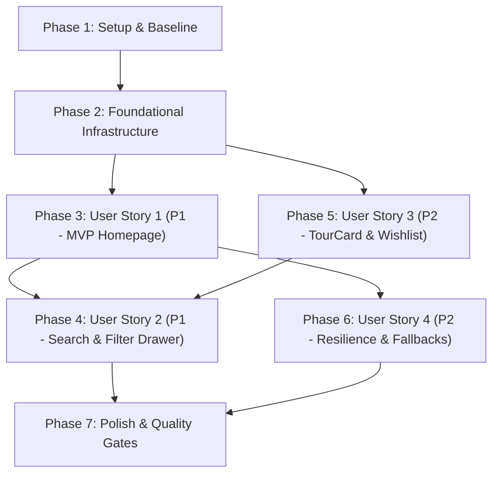

# Tasks: Homepage and Discovery Redesign (Spec 021)

**Input**: Design documents in `specs/021-homepage-discovery/`  
**Prerequisites**: [plan.md](plan.md), [spec.md](spec.md), [research.md](research.md), [data-model.md](data-model.md), [API contract](contracts/homepage-discovery-api.md), [UI contract](contracts/discovery-ui-contracts.md), [quickstart.md](quickstart.md)  
**Spec ID / Master-plan phase**: Spec 021 / Phase 4 — Homepage and Discovery  
**Governing Constitution**: [Bookly Constitution v2.1.0](../../.specify/memory/constitution.md)  
**Baseline / Branch**: `021-homepage-discovery` at `6fcdbb83578f1beede7bf2512d60b1ad76054f0f` (incorporating accepted Spec 020 Tour Detail Experience verification, Jest 857/857 pass, and strict Lighthouse reports).  
**Created**: 2026-10-29 (Africa/Cairo)  
**Status**: Implementation complete: 47/47 tasks accepted (100% complete).

**Organization**: Setup & baseline, Foundational prerequisites, User Story 1 (P1 - MVP), User Story 2 (P1), User Story 3 (P2), User Story 4 (P2), and Polish / Quality Gates.

---

## Format: `[ID] [P?] [Story] Description`

- **[P]**: Parallelizable task (independent file targets without incomplete dependencies).
- **[Story]**: Mapped user story (`[US1]`, `[US2]`, `[US3]`, `[US4]`). Omitted for Setup, Foundational, and Polish phases.
- Every task includes explicit repository-relative file paths.

---

## Phase 1: Setup & Baseline (Shared Infrastructure)

**Purpose**: Verify the environment, test runners, and test fixtures without mutating existing production code.

- [X] T001 Verify active git branch `021-homepage-discovery`, active feature directory `specs/021-homepage-discovery`, and test runners in `frontend/package.json` and `backend/phpunit.xml`.
- [X] T002 [P] Create mock fixture builders for homepage data (complete, partial-missing-blog, empty-curated-rails, failed-core) in `frontend/tests/fixtures/homepage-discovery.ts`.
- [X] T003 [P] Capture baseline Jest and Playwright discovery test executions in `specs/021-homepage-discovery/evidence/baseline.md`.

**Checkpoint**: Development baseline is explicit and immutable test fixtures are available.

---

## Phase 2: Foundational Infrastructure (Blocking Prerequisites)

**Purpose**: Core data models, backend endpoints, and client storage helpers required by all user stories.

**⚠️ CRITICAL**: Must complete before user story phases begin.

- [X] T004 Update TypeScript interfaces in `frontend/src/lib/api/types.ts` adding `CuratedRail`, updated `HomepageData` with `curated_rails`, and standardized `TourCard` fields (`badge`, `price` object, `rating` object).
- [X] T005 [P] Implement `guestWishlist.ts` in `frontend/src/lib/wishlist/guestWishlist.ts` with `getGuestWishlist`, `toggleGuestWishlist`, `clearGuestWishlist`, and `mergeGuestWishlist` backed by versioned browser `localStorage`.
- [X] T006 [P] Extend Laravel backend `GetHomepageDataAction.php` in `backend/app/Domains/Search/Actions/GetHomepageDataAction.php` to aggregate bookable themed `curated_rails` (Family, Adventure, Seasonal).
- [X] T007 [P] Add PHPUnit test in `backend/tests/Feature/Search/HomepageTest.php` verifying `curated_rails` serialization, empty rail omission, and caching in `GET /api/public/homepage`.
- [X] T008 Add `POST /api/public/wishlist/merge` route in `backend/routes/api/public.php` and controller action in `backend/app/Domains/Traveler/Controllers/Public/WishlistController.php` to deduplicate and batch-merge guest wishlist tour IDs into authenticated accounts.

**Checkpoint**: Foundation ready — backend supplies `curated_rails`, types are aligned, and guest wishlist storage is operational.

---

## Phase 3: User Story 1 - Discover & Explore Curated Experiences on Homepage (Priority: P1) 🎯 MVP

**Goal**: Deliver the 10-section vertical homepage hierarchy with category chips, value panel, featured tours, destinations, themed rails.

**Independent Test**: Load `http://localhost:3000/[locale]` in `en`, `es`, `it`. Verify all 10 sections render in exact sequence and category chips navigate to filtered search.

### Tests for User Story 1
- [X] T009 [P] [US1] Add unit test in `frontend/src/components/home/__tests__/CategoryChips.test.tsx` verifying category chips render with localized labels and link to `/[locale]/search?category=<slug>`.
- [X] T010 [P] [US1] Add unit test in `frontend/src/components/home/__tests__/BooklyValuePanel.test.tsx` verifying marketplace trust guarantees render without third-party advertisements.
- [X] T011 [P] [US1] Add unit test in `frontend/src/components/home/__tests__/ThemedTourRails.test.tsx` verifying non-empty `curated_rails` render and empty rails are omitted.

### Implementation for User Story 1
- [X] T012 [P] [US1] Implement `CategoryChips.tsx` in `frontend/src/components/home/CategoryChips.tsx` featuring horizontal touch scrolling and direct navigation to `/[locale]/search?category=<slug>`.
- [X] T013 [P] [US1] Implement `BooklyValuePanel.tsx` in `frontend/src/components/home/BooklyValuePanel.tsx` presenting Bookly guarantees using design system tokens.
- [X] T014 [P] [US1] Implement `ThemedTourRails.tsx` in `frontend/src/components/home/ThemedTourRails.tsx` dynamically mapping over non-empty `curated_rails`.
- [X] T015 [US1] Update `FeaturedTours.tsx` in `frontend/src/components/home/FeaturedTours.tsx` supporting horizontal snap scrolling, desktop step buttons, and passing `imagePriority={true}` to the first card.
- [X] T016 [US1] Update `CategoryGrid.tsx` in `frontend/src/components/home/CategoryGrid.tsx` to render responsive category cards with tour counts and image fallback states.
- [X] T017 [US1] Update `DestinationShowcase.tsx` in `frontend/src/components/home/DestinationShowcase.tsx` to render top destination cards with localized tour counts.
- [X] T018 [US1] Update `HeroSection.tsx` in `frontend/src/components/home/HeroSection.tsx` with "Where to?" headline, localized subtitle, and embedded search bar.
- [X] T019 [US1] Rebuild homepage server component in `frontend/src/app/[locale]/(public)/page.tsx` rendering all 10 sections in strict vertical hierarchy with next-intl localization.
- [X] T020 [US1] Add e2e Playwright test in `frontend/tests/e2e/homepage.spec.ts` validating 10-section hierarchy, category chip navigation, and destination links.

**Checkpoint**: User Story 1 (MVP) is fully functional and testable independently.

---

## Phase 4: User Story 2 - Search and Filter Tours with Complete State Preservation (Priority: P1)

**Goal**: Deliver a comprehensive search experience with desktop sidebar, mobile staged filter drawer, active filter chips, and URL history synchronization.

**Independent Test**: Execute searches, apply multiple filters and sorting on desktop and mobile viewports, verify sticky drawer "Show [N] Tours" staging, and confirm URL state survives page reloads and Back/Forward navigation.

### Tests for User Story 2
- [X] T021 [P] [US2] Add unit test in `frontend/src/components/search/__tests__/FilterSidebar.test.tsx` verifying price, category, rating, and duration filter updates on desktop.
- [X] T022 [P] [US2] Add unit test in `frontend/src/components/search/__tests__/MobileFilterDrawer.test.tsx` verifying staged filter state, sticky "Show [N] Tours" action, and reset functionality.
- [X] T023 [P] [US2] Add unit test in `frontend/src/components/search/__tests__/ActiveFilterChips.test.tsx` verifying individual chip dismissal and clear-all action.

### Implementation for User Story 2
- [X] T024 [P] [US2] Implement `ActiveFilterChips.tsx` in `frontend/src/components/search/ActiveFilterChips.tsx` rendering dismissible filter pills and a "Clear all" action.
- [X] T025 [P] [US2] Implement `FilterSidebar.tsx` in `frontend/src/components/search/FilterSidebar.tsx` for desktop ($\ge 1024\text{px}$) with reactive price, category, rating, and duration controls.
- [X] T026 [US2] Implement `MobileFilterDrawer.tsx` in `frontend/src/components/search/MobileFilterDrawer.tsx` with focus trapping, touch targets $\ge 44\times44\text{px}$, staged filter state, and sticky "Show [N] Tours" confirmation bar.
- [X] T027 [US2] Update `SearchBar.tsx` in `frontend/src/components/search/SearchBar.tsx` to handle text input, preserve query state, and navigate with encoded search terms.
- [X] T028 [US2] Redesign search results route in `frontend/src/app/[locale]/(public)/search/page.tsx` integrating `FilterSidebar`, `MobileFilterDrawer`, `ActiveFilterChips`, dense results grid, sort dropdown, and empty state.
- [X] T029 [US2] Add e2e Playwright test in `frontend/tests/e2e/search.spec.ts` validating filter drawer staged apply, chip removal, sort controls, and URL parameter persistence across navigation.

**Checkpoint**: User Story 2 is fully functional with desktop sidebar, mobile drawer, and URL synchronization.

---

## Phase 5: User Story 3 - Inspect Redesigned Tour Cards & Manage Wishlist (Priority: P2)

**Goal**: Standardize the 4:3 `TourCard` atom across rails and grids with an unauthenticated `localStorage` guest wishlist, login merge, badges, and WCAG AA focus rings.

**Independent Test**: Toggle wishlist on tour cards as guest and authenticated user, inspect badge variants, verify `localStorage` persistence, and confirm post-login deduplication merge and logout cache purging.

### Tests for User Story 3
- [X] T030 [P] [US3] Add unit test in `frontend/src/components/search/__tests__/TourCard.test.tsx` validating 4:3 image ratio, contextual metadata, 2-line title, ratings, duration, badges, and focus rings.
- [X] T031 [P] [US3] Add unit test in `frontend/src/lib/wishlist/__tests__/useWishlist.test.ts` validating guest `localStorage` toggling, authenticated API sync, and optimistic UI rollback.

### Implementation for User Story 3
- [X] T032 [P] [US3] Implement `WishlistHeartButton.tsx` in `frontend/src/components/shared/WishlistHeartButton.tsx` with $\ge 44\times44\text{px}$ touch target, active/inactive heart states, and ARIA live announcements.
- [X] T033 [US3] Implement `useWishlist.ts` hook in `frontend/src/lib/wishlist/useWishlist.ts` coordinating guest `localStorage` and authenticated Sanctum API wishlist.
- [X] T034 [US3] Redesign `TourCard.tsx` in `frontend/src/components/search/TourCard.tsx` standardizing on 4:3 image ratio, Bookly badges (`featured`, `best-seller`, `new`), gold star ratings, duration, pricing, and embedding `WishlistHeartButton`.
- [X] T035 [US3] Integrate guest-to-account wishlist merge upon login/registration in `frontend/src/components/auth/LoginForm.tsx` and `RegisterForm.tsx`, and clear client storage on logout.
- [X] T036 [US3] Add Playwright e2e test in `frontend/tests/e2e/wishlist.spec.ts` validating guest bookmarking, reload persistence, post-login merge, and logout data isolation.

**Checkpoint**: User Story 3 is complete with unified TourCard and guest wishlist lifecycle.

---

## Phase 6: User Story 4 - Resilient Discovery under Partial or Failing Network States (Priority: P2)

**Goal**: Isolate section-level failures so partial data errors omit only the affected section without crashing the homepage, and provide a polite recovery banner on core failures.

**Independent Test**: Mock blog feed failure and empty seasonal rails; verify surviving sections render cleanly without white space or console errors. Mock core catalog failure; verify recovery alert renders with working search.

### Tests for User Story 4
- [X] T037 [P] [US4] Add unit test in `frontend/src/app/[locale]/(public)/__tests__/page-resilience.test.tsx` validating that blog feed failures and missing curated rails degrade silently.

### Implementation for User Story 4
- [X] T038 [US4] Implement section isolation error boundaries in `frontend/src/components/home/HomeErrorBoundary.tsx` ensuring partial section failures omit only the broken element.
- [X] T039 [US4] Implement localized catalog error recovery banner in `frontend/src/components/home/CatalogRecoveryAlert.tsx` displayed when core homepage data fails, keeping hero search available.
- [X] T040 [US4] Add image placeholder fallback in `frontend/src/components/ui/ImageWithFallback.tsx` preventing layout shifts (CLS $\le 0.05$) on broken or slow image URLs.

**Checkpoint**: User Story 4 resilience and error boundaries verified.

---

## Phase 7: Polish, Accessibility & Quality Gates

**Purpose**: Cross-cutting localization, accessibility audit, performance budgets, and final verification ledger.

- [X] T041 [P] Externalize all new UI strings across `frontend/src/messages/en.json`, `es.json`, `it.json`, and `ar.json` (zero hardcoded strings).
- [X] T042 [P] Validate keyboard navigation and visible focus rings across all cards, chips, and drawer controls in `frontend/tests/e2e/a11y.spec.ts`.
- [X] T043 Execute full Axe-core accessibility test suite (`npm run test:a11y`) and confirm zero WCAG 2.1 AA violations.
- [X] T044 Execute complete frontend Jest test suite (`npm test`) and TypeScript typecheck (`npm run typecheck`) confirming 0 errors.
- [X] T045 Execute complete Playwright e2e discovery test suite across desktop and mobile viewports.
- [X] T046 Run Lighthouse CI audit on homepage and search listing confirming Performance $\ge 90$, Accessibility $\ge 90$, and CLS $\le 0.05$.
- [X] T047 Record final verification evidence, test output, and performance metrics in `specs/021-homepage-discovery/verification.md`.

---

## Dependencies & User Story Completion Order

### Parallel Opportunities

- **Within Phase 2**: `T005` (guestWishlist.ts), `T006` (GetHomepageDataAction.php), and `T007` (HomepageTest.php) can proceed concurrently.
- **Within Phase 3 (US1)**: `T009`, `T010`, `T011` (unit tests) and `T012`, `T013`, `T014` (new components) can be implemented in parallel.
- **Within Phase 4 (US2)**: `T021`, `T022`, `T023` (search tests) and `T024`, `T025` (filter components) can be built in parallel.
- **Within Phase 5 (US3)**: `T030`, `T031` (tests) and `T032` (WishlistHeartButton) can be built in parallel.
- **Cross-Story Parallelism**: Once Phase 2 is complete, User Story 1 (Homepage) and User Story 3 (TourCard & Wishlist) can be developed concurrently on separate files.

---

## Implementation Strategy: MVP First

1. **MVP Increment (Phases 1, 2, 3)**:
   - Delivers the 10-section homepage hierarchy, category chips, Bookly value panel, and themed rails.
   - Fully testable independently via `frontend/tests/e2e/homepage.spec.ts`.
2. **Second Increment (Phase 4)**:
   - Delivers the search results redesign, desktop filter sidebar, and mobile staged filter drawer.
3. **Third Increment (Phases 5, 6)**:
   - Standardizes the 4:3 `TourCard` with guest `localStorage` wishlist and section error resilience.
4. **Final Gate (Phase 7)**:
   - Complete localization in 4 languages, Axe accessibility verification, and Lighthouse CI performance audits.
