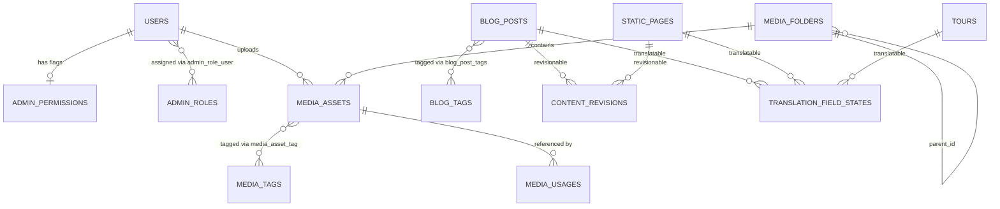

# Data Model: Bookly Admin 2.0 (Spec 035)

See companion report [`docs/reports/admin-2.0-database-impact.md`](file:///f:/Travel%20Website/bookly%20travel/docs/reports/admin-2.0-database-impact.md) for the complete schema impact analysis.

---

## 1. Entity-Relationship Summary

---

## 2. Field-Level Translation State Machine (`translation_field_states`)

- **Unique Key:** `(translatable_type, translatable_id, locale, field_name)`
- **Field Statuses:**
  - `missing` — Target field is empty and no job is queued.
  - `pending` — Queued for AI translation (`TranslateContentFieldJob`).
  - `processing` — Worker is actively translating the field.
  - `completed` — AI translation succeeded, passed quality & HTML sanitization checks, and `translated_source_hash === source_hash`.
  - `manually_edited` — Admin manually edited the target field (`origin = 'manual'`) and `translated_source_hash === source_hash`.
  - `outdated` — English source changed (`translated_source_hash !== source_hash`). If `origin = 'ai'`, automatically re-queued; if `origin = 'manual'`, preserved until explicit admin regeneration.
  - `failed` — AI translation exhausted retries or failed validation (`last_error_code` recorded).
- **Aggregate Language Statuses (computed by `TranslationHealthCheckService`):**
  - `complete` — All required fields for the content type are populated in storage AND in `completed` or current `manually_edited` state matching current English `source_hash`.
  - `processing` — At least one field is `pending` or `processing`.
  - `failed` — At least one required field is `failed`.
  - `outdated` — At least one field has `translated_source_hash !== source_hash`.
  - `incomplete` — At least one translated field exists, but one or more required fields are empty/`missing`.
  - `not_started` — All translatable fields for the locale are empty/`missing`.

